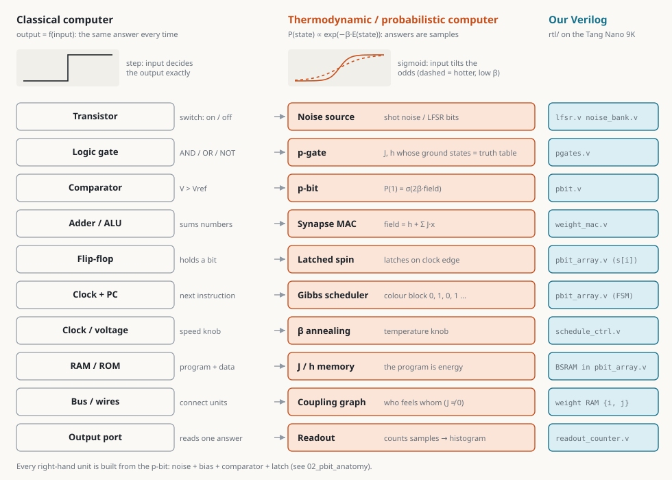
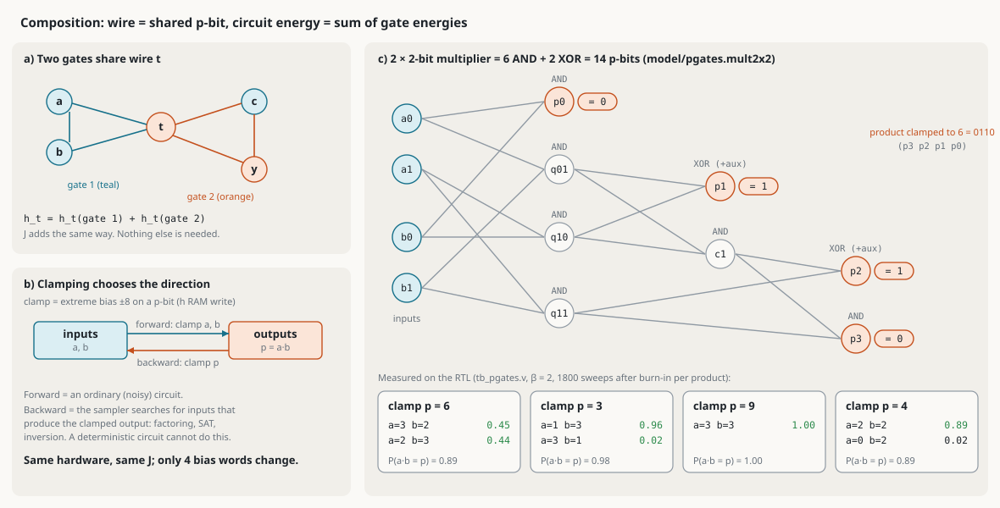

# Thermodynamic / probabilistic computer — reverse-engineered from the sources, emulated on a Tang Nano 9K

This repository reconstructs how an Extropic-style probabilistic computer is built, **using only the papers in `data/` and the examples in `thrml/` and `torx/`**. It then implements a bit-exact, verified digital emulation in Verilog for the Sipeed Tang Nano 9K (GW1NR-9).

Every technical claim in `docs/` is cited and tagged:
- **[DOCUMENTED]**: stated in a source.
- **[INFERRED]**: reconstructed from the sources.
- **[FPGA-APPROX]**: our digital design choice.
- **[NOT IN SOURCES]**: the sources don't say.

## In pictures

| | |
|---|---|
|  |  |
| **Basic units**: every classical block and its thermal twin | **One p-bit**: physical cell vs our Verilog, stage by stage |
|  |  |
| **p-gates**: AND/OR/NOT/XOR as energy landscapes | **Connecting units**: a multiplier that runs backwards and factors 6 |

All seven drawings with explanations: [`docs/04_basic_units.md`](docs/04_basic_units.md). Interactive version, with a live p-bit, a gate lab, a factoring demo and annealing: open [`docs/explainer.html`](docs/explainer.html) in a browser.

## The answer in one paragraph

The thermodynamic "gate" is the **p-bit sampling cell**. Its parts:
- A resistor network sums the neighbours' states, sign-corrected by XOR, into a bias voltage. This is the synapse/MAC.
- That voltage shifts Gaussian transistor noise in front of a comparator. This is the RNG, with P(1) ≈ σ(2β(ΣJx+h)).
- The bit is latched on the clock and broadcast to the neighbours. This is the flip-flop.

Grids of such cells on a sparse two-colourable graph are swept by **chromatic Gibbs sampling** under a global clock; the clock and update scheduler take the role of the program counter. Annealing raises β, i.e. scales the weights. Readout means drawing samples.

Denoising models chain several such EBMs, where the previous output x^t is clamped and coupled pairwise to the new x^{t−1} [DTM paper, pp. 4-5, 23-25, 37]. At the software level, the Boolean gate set is replaced by stochastic matrices: PNOT, PSWAP, PCNOT, PIsing… [SDP paper, pp. 6, 17]. See `docs/02_building_blocks.md` for the full classical ↔ thermodynamic table.

## File map

```
data/                 source papers (PDF), read with pdftotext
thrml/, torx/         source examples (Extropic THRML / Torx)
docs/
  00_inventory.md     every source file, summary and relevance
  01_evidence.md      concept | what sources say | tag | citation
  02_building_blocks.md  classical <-> thermodynamic blocks, composition
  03_diagrams.md      Mermaid diagrams: every FPGA module + system
  04_basic_units.md   the basic units in pictures (SVGs in img/units/)
  05_pgates.md        p-gates: AND/OR/NOT/XOR, full adder, factoring by running backwards
  explainer.html      interactive explainer (built by tools/build_explainer.py)
  06_verification.md  real simulation output, TV/KL, plots (img/)
  07_fpga.md          Tang Nano 9K: pins, real utilisation/timing, fit study
  08_limitations.md   what the emulation does not capture, paper claims, next steps
  09_programming.md   how to program the chip: problem files, solve, --sim (start here to use it)
model/
  fixed.py            BIT-ACCURATE spec (Q-formats, LFSR, sigmoid LUT, schedule; dense + sparse/parallel samplers)
  golden.py           float chromatic Gibbs + exact Boltzmann + TV/KL
  cases.py            test problems (torx/06 ring, Max-Cut, torx/16 grid, DTM G8/G12 grids)
  export_vectors.py   -> model/vectors/*.hex (RTL init files + expected traces)
  denoise.py          DTM-style denoising chain (mirror of denoise_demo.v)
  pgates.py           p-gate gadgets, composition, clamping, scenarios
  tempering.py        parallel tempering spec (replica exchange, swap = p-bit on the energy gap)
  pmode.py            continuous p-mode spec (fixed-point Langevin soft spins, Gaussian LUT)
  train.py            Boltzmann-machine learning with the chip as sampler (AND, XOR + hidden, ring8)
  uart_script.py      byte-level model of the whole top.v + UART session scripts for tb_top_script.v
  problem.py          user problem files (ising / maxcut / qubo / circuit JSON) -> programmed J, h, schedule
  ml.py               ML demos: glyphs, bars & stripes, Hopfield, MRF denoising, digits RBM (data + builders)
  pysim.py            ideal float simulator: chromatic Gibbs, any size, parallel chains, SimTrainer, RBM
  pmode_learn.py      p-mode chip learns a p-mode circuit's couplings from its samples
examples/             problem files: factor6, maxcut_pentagon, qubo_small, ring8
web/                  web viewer of every chip: Python model / Verilog RTL (Verilator) / board, same UART bytes (web/README.md)
rtl/
  lfsr.v noise_bank.v          noise source (Galois LFSR, 4 polynomials, optional ring osc.)
  sigmoid_lut.v sigmoid_pwl.v  sigma: 1024x16 BSRAM table / shift-add piecewise linear
  weight_mac.v coupling_row.v  multiplier-free +-J synapse accumulator
  pbit.v                       field x beta (shift-add) -> sigma -> compare with noise
  schedule_ctrl.v              beta annealing (const / linear / table)
  pbit_array.v                 N p-bits, J/h/order RAMs, chromatic Gibbs FSM (dense, one engine)
  sparse_array.v               N <= 256 p-bits, neighbour lists (degree <= D), P parallel lanes
  readout_counter.v            histogram + per-spin counters
  uart_rx.v uart_tx.v top.v    host link + command FSM + LEDs/buttons
  denoise_demo.v               toy denoising chain (T=4)
  pgates.v                     p-gate: gate/circuit sampler with clamp inputs (fwd / bwd), K replicas
  temper_ctrl.v                parallel tempering controller beside pbit_array (K <= 4 replicas)
  pmode_array.v pmode_top.v    continuous Langevin p-modes (M <= 16) + stand-alone board top
tb/                   testbenches, Makefile, compare.py (TV/KL), plot_hist.py, plot_pgates.py,
                      tb_top_script.v (any UART session), noise_study.py, pmode_study.py
fpga/                 tangnano9k.cst, Makefile, sweep_/case_/sparse_/pmode_wrapper.py, host.py, entropy.py
tools/cite.py         grep PDF text with page numbers (used for citations)
tools/make_diagrams.py   draws docs/img/units/*.svg from the model + measured results
tools/build_explainer.py builds docs/explainer.html
```

## How to run the simulation

Prerequisites: the OSS CAD Suite (installed here in `~/tools/oss-cad-suite`, no sudo), plus system Python 3 with numpy, matplotlib and networkx.

```bash
source ~/tools/oss-cad-suite/environment
cd tb
make test      # unit tests + bit-exact pbit_array vs model/fixed.py (5 cases + PWL) + verilator -Wall lint   (~1 min)
make stats     # 200k-sweep Verilator runs, TV/KL vs exact Boltzmann + golden, plots in tb/build/          (~6 min)
make top       # whole chip driven over UART, byte-for-byte vs Python replay
make denoise   # denoising chain, bit-exact per step
make pgates    # p-gates forward + backward, full adder, factor 6/3/9/4 on the RTL   (~3 min)
make sparse    # sparse_array (P = 1/2/4 lanes) bit-exact vs model, incl. 256-node G12 grids   (part of make test)
make stats-sparse  # long sparse runs: TV vs exact (small), energy/|m| vs float Gibbs (256 nodes)
make top-sparse    # SPARSE top (N = 256, P = 4) programmed and run over UART, byte-for-byte vs Python
make noise     # RNG persistence (tau0) and shared-noise study, raw-noise entropy   (~4 min)
make train     # learning loop: AND / XOR + hidden / ring8 recovery, RTL replay of 3 epochs   (~4 min)
make pmode     # continuous p-modes: bit-exact + histograms vs exact e^(-V/T)   (~1.5 min)
make script    # UART sessions (noise, tempering) through tb_top_script.v vs model/uart_script.TopModel
/usr/bin/python3 compare.py --anneal   # Max-Cut annealing quality
```

Notes:
- The OSS CAD Suite environment shadows `python3` with one that has no numpy, so the Makefile uses `/usr/bin/python3` (override with `PY=`).
- Verilator cannot build in a path containing spaces, so its objects go to `VL_BUILD=/tmp/pbit_vl_$USER`.

Headline results (details in `docs/06_verification.md`):
- RTL ≡ `model/fixed.py` bit for bit: every post-sweep state over 200,000 sweeps per case.
- RTL histogram vs exact Boltzmann: TV = 0.0092 (ring8), 0.0341 (maxcut12, 4096 states). These equal the TV of the same number of *independent* exact samples (0.0085, 0.0333).
- Quantization: Q3.4 weights shift torx/06's ring by TV 0.053; Q1.6 reduces that to 0.013.
- maxcut16 annealing reaches the brute-force optimum cut in 96% of runs.
- The whole top level over UART matches the Python replay: 16,767/16,767 bytes.
- Added 2026-10-30 (docs/06 §7-11):
  - **Parallel tempering** (K = 4) makes factor 3 sample both pre-images: TV 0.47 → 0.065 at the same sweep budget.
  - **Learning loop**: the chip learns AND (rediscovering the hand gadget), XOR with one hidden unit (KL 0.64 → 0.05), and recovers the ring8 couplings within one Q3.4 step.
  - **Continuous p-modes** reproduce float Langevin (TV 0.01-0.02).
  - **Slow RNGs** (τ0) leave the law unchanged but slow mixing as 1/q; **shared noise** between parallel cells biases it (TV 0.34).
  - All of these are bit-exact RTL ↔ model.

## Web viewer

```bash
/usr/bin/python3 web/server.py      # http://localhost:8000
```
One page for every chip build: architecture, programming, a live sampler, results and the UART wire. The page runs each chip on the Python model, on the real Verilog (Verilator), or on the board, and can check model == RTL byte for byte. See `web/README.md`.

## How to build for the Tang Nano 9K

```bash
source ~/tools/oss-cad-suite/environment
cd fpga
make            # yosys synth_gowin -> nextpnr-himbaechel (GW1N-9C) -> gowin_pack -> build/top.fs
make report     # LUT4 2801/8640 (32%), DFF 1326, BSRAM 10/26, 0 DSP, Fmax 63.41 MHz (27 MHz target)
make flash      # openFPGALoader -b tangnano9k build/top.fs   (SRAM; make flash-fl for flash)
make sweep      # fit study N = 8..128 (N = 64 fits at 83% LUT; N = 128 does not)
make case CASE=factor6   # power-on program = 2x2 multiplier run backwards on 6 (LUT 27%, 69.46 MHz)
make case CASE=factor6_pt   # same with parallel tempering K = 4 (LUT 42%, 43.26 MHz)
make sparse SNOISE=1     # SPARSE N = 256 with the 'Y' noise options (LUT 81%, 37.05 MHz)
make pmode PMCASE=chain4 # continuous p-modes, LED demo (LUT 13%, 7 MULT18X18, 52.26 MHz); make pmode-fit for M = 8/16
make flash-case          # run button anneals; LEDs 0-3 = a0 a1 b0 b1 (expect a,b = 3,2 or 2,3)
python3 host.py --port /dev/ttyUSB1 pgate --case pgate_and --clamp Y=1
python3 host.py --port /dev/ttyUSB1 sample --case maxcut12 --sweeps 20000
python3 host.py --port /dev/ttyUSB1 train --case xor_h        # learning loop, board as sampler
python3 host.py --port /dev/ttyUSB1 entropy --sweeps 100000   # raw noise statistics (RO_JITTER study)
python3 host.py --port /dev/ttyUSB1 temper --case factor6_pt --clamp p0=1,p1=1,p2=0,p3=0   # TEMPER_K build
python3 host.py --port /dev/ttyUSB1 solve --problem ../examples/factor6.json   # your own program (docs/09)
python3 host.py --sim solve --problem ../examples/qubo_small.json              # same, no board (Python model)
```
`nextpnr-gowin`, named in the original request, is not in current OSS CAD Suite; `nextpnr-himbaechel` is its replacement. Bitstream generation was run. **Flashing and `host.py` were not run, because no board was attached.** After power-up the board works stand-alone: the run button (pin 3) anneals the built-in 16-node Max-Cut instance and shows spins on the LEDs.

## Open questions — where the sources were insufficient

1. **Transistor-level RNG.** DTM App. K says "a digitizing comparator fed by a source of Gaussian noise" and delegates the noise circuit to its Ref. [16], which is not in `data/`. The noise-source schematic, bias-control circuit and comparator design are [NOT IN SOURCES].
2. **Tunable conductances.** DTM states that "tunable resistors do not exist" (p.30), but does not say how the weights are actually realized (DAC + transistor? capacitor arrays?). X0 uses 8-bit DACs for controls (SDP p.20), but the mapping to J_ij is not described.
3. **β in hardware.** The equations carry a global β, but no hardware temperature knob is described for DTCA. We assume β is folded into the programmed weights, as thrml/03 does in software.
4. **Sign of the forward coupling (Eq. D1).** As printed it would anti-align x^t and x^{t−1}. B20 and the text imply alignment. We use the ferromagnetic sign [INFERRED].
5. **Probit vs sigmoid.** A comparator on Gaussian noise gives a probit curve; the paper only says the measurement is "well-approximated by a sigmoid". The exact curve and calibration are not given beyond "≈5 % calibration error" on X0.
6. **Trained DTM weights.** No small trained model or weight file is in the sources, so the denoising demo uses hand-set Hebbian weights.
7. **Z1 details.** Z1 has a "degree-16 interaction graph", but the pattern, weight precision and sweep rate are not specified.
8. **AND/OR/NOT via energy composition** is mentioned (Blueprint p.3) without coefficients. We now use the standard Ising gadgets (docs/05). They work, but they are ours, not the papers'.
9. **Superconducting thermodynamic neuron to p-bit readout** (Blueprint Sec. VIII) is described as "currently limited to binary readout". How it would couple into a digital array is not specified.
10. **Tang Nano 9K button mapping.** Which silkscreen button is on pin 3 vs pin 4 is inconsistent across Sipeed's own examples; see `docs/07_fpga.md`.
