# 03 — Diagrams

Paper short names as in `docs/01_evidence.md`. These Mermaid diagrams show the **FPGA modules**. For pictures of the **basic units themselves** (classical ↔ thermodynamic map, p-bit anatomy, p-gates, composition, stack, timing, board), see `docs/04_basic_units.md` (SVGs in `docs/img/units/`) and the interactive `docs/explainer.html`. Each diagram here has two parts. The **physical** side reproduces what the papers describe. The **FPGA** side shows our digital emulation.

## D1. Physical sampling cell (DTM Fig. 10)

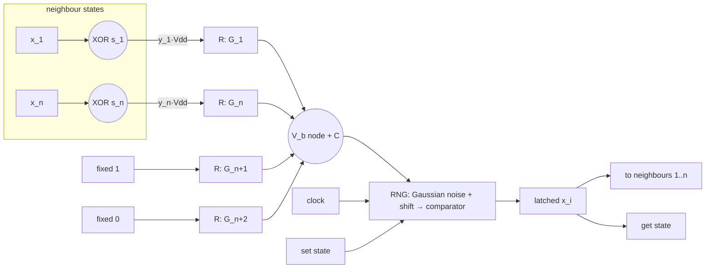
*Caption:* [DOCUMENTED] resistor-network bias, XOR sign correction, RNG latched by the clock, set/get state [DTM, p.25, Fig. 10; p.26, Eqs. E1-E7]. RNG internals: Gaussian noise + control voltage → comparator [DTM, p.38, Fig. 15a; p.37, App. K].

## D2. Noise source — `lfsr.v` / `noise_bank.v`

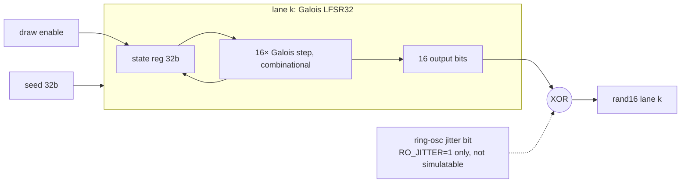
*Caption:* [FPGA-APPROX] replaces the subthreshold shot-noise RNG [DTM, p.6; p.37]. Each lane uses a distinct primitive polynomial, verified in `model/fixed.py`. The physical RNG's τ0 corresponds to "one draw per update" here.

## D3. Sigmoid unit — `sigmoid_lut.v` / `sigmoid_pwl.v`

```mermaid
flowchart LR
  LOG[logit Q5.5, 10b signed] --> OFF[+512 offset]
  OFF --> ROM[(1024 × 16b ROM, BSRAM<br/>p = round 65536·σ)]
  ROM --> P[p16]
  LOG --> PWL[|x| segments, shifts + adds]
  PWL --> P2[p16 PWL]
```
*Caption:* [DOCUMENTED] sigmoidal bias response [DTM, p.6, Fig. 4a; p.5, Eq. 11]. [FPGA-APPROX] the LUT and PWL quantization.

## D4. Weight MAC — `weight_mac.v` / `coupling_row.v`

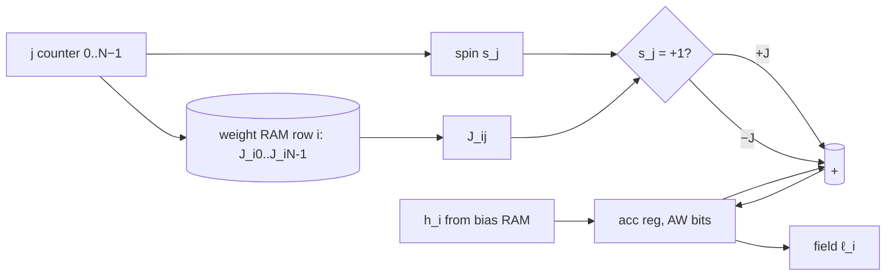
*Caption:* [DOCUMENTED] MAC of weights and neighbour states, with sign set by XOR [DTM, p.26, Eq. E7]. [FPGA-APPROX] serial accumulation, one term per clock, no DSP.

## D5. p-bit — `pbit.v`

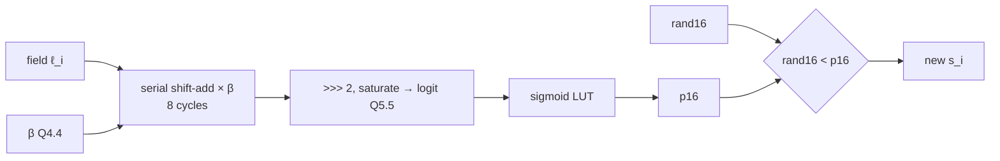
*Caption:* [DOCUMENTED] P(x_i=+1) = σ(2β(ΣJx + h)) [DTM, p.5, Eq. 11]. [FPGA-APPROX] `rand < p` is the inverse-CDF form of the "noise vs threshold" comparator [DTM, p.37].

## D6. Annealing controller — `schedule_ctrl.v`

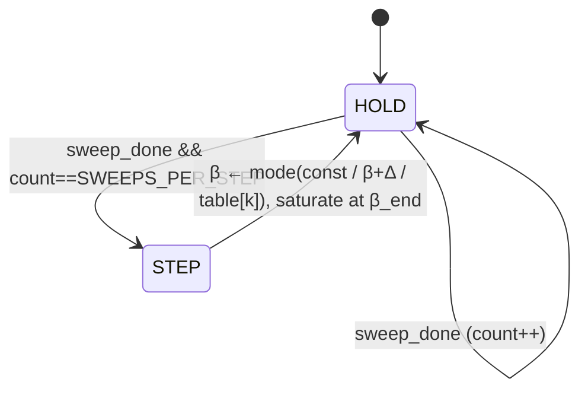
*Caption:* [DOCUMENTED] increasing-β schedule with fixed sweeps per β [thrml/03_codon_optimization.py:L322-344]. [FPGA-APPROX] Q4.4 β and linear/table modes.

## D7. p-bit array + scheduler — `pbit_array.v`

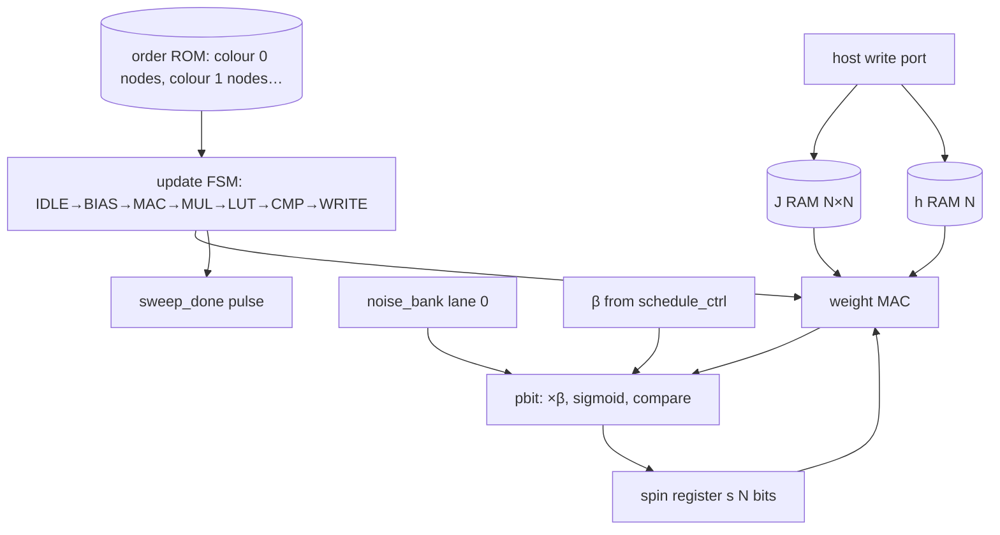
*Caption:* [DOCUMENTED] chromatic Gibbs over colour blocks [DTM, p.5; p.21, Fig. 8; torx/06_ising_sampling_contrastive_divergence.py:L198-208]. [FPGA-APPROX] one time-multiplexed engine instead of one circuit per node. [INFERRED] sequential updates within a colour equal the block update (docs/02 §2.2).

## D8. Readout — `readout_counter.v`

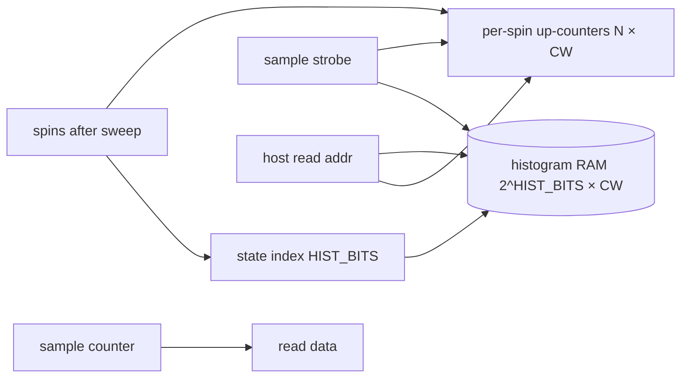
*Caption:* [DOCUMENTED] readout = drawing samples, then histograms/expectations [torx/04_execution_interface_readouts.py:L98-118, L202]. [FPGA-APPROX] on-chip counters avoid streaming every sample over UART.

## D9. Denoising chain — `denoise_demo.v`

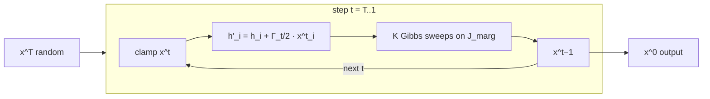
*Caption:* [DOCUMENTED] chained EBMs with forward coupling between x^t and x^{t−1} [DTM, p.4, Eqs. 7-8, Fig. 3; p.23-24, Eq. D1, Fig. 9b]. [INFERRED] clamping = bias offset. [FPGA-APPROX] hand-set Hebbian J_marg and no latent nodes.

## D10. System level — `top.v` on Tang Nano 9K

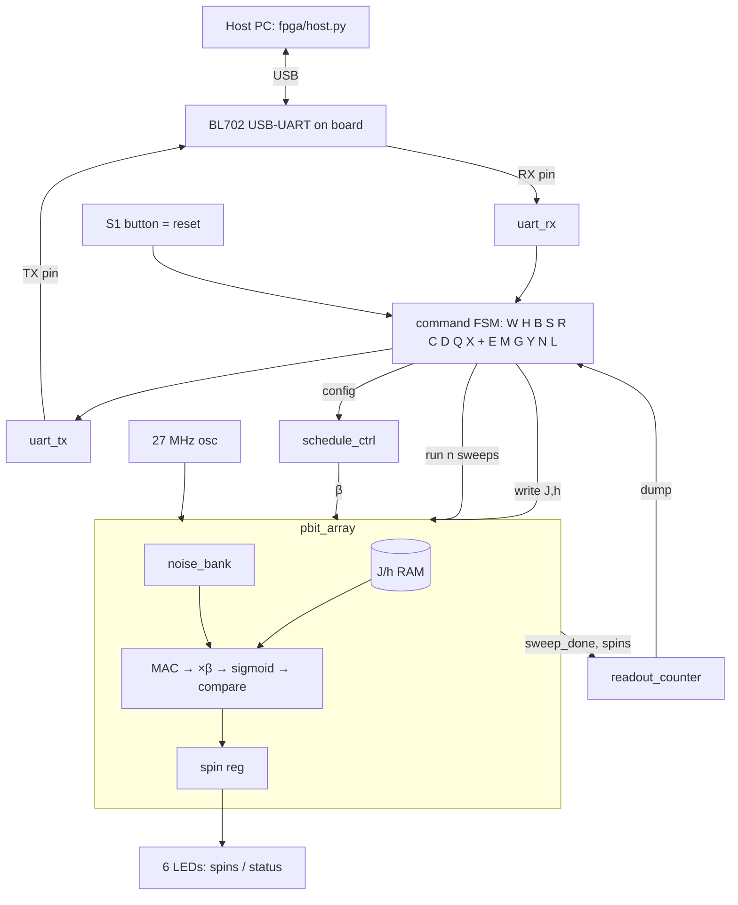
*Caption:* [DOCUMENTED] the host-plus-FPGA-plus-sampler architecture mirrors XTR-0 [SDP, p.9, Fig. 6] and the Z1 host↔chip h, J protocol [SDP, p.9, Fig. 7]. [FPGA-APPROX] every block on the FPGA side.

## D11. p-gate — `pgates.v` (docs/05)

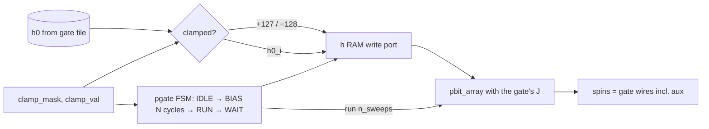
*Caption:* [NOT IN SOURCES] gadget coefficients (model/pgates.py). [INFERRED] clamping = bias offset. Forward = clamp inputs, backward = clamp outputs. Picture: `docs/img/units/03_pgates.svg`, `04_composition.svg`.

## D12. Sparse parallel array — `sparse_array.v` (added 2026-10-29)

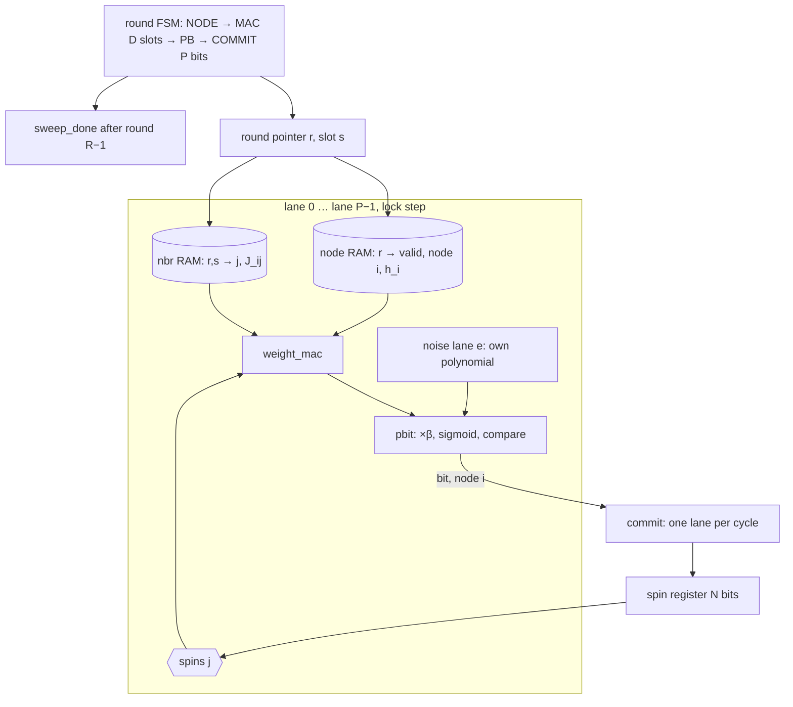
*Caption:* [DOCUMENTED] sparse local connectivity, G8/G12 grid patterns and block-parallel Gibbs updates of a two-colourable graph [DTM, p.5; p.24, Table II]. [INFERRED] nodes of one round share a colour block, so they are uncoupled and the parallel update equals the sequential one; this is what makes the RTL bit-exact with `model/fixed.SparseParallelSampler`. [FPGA-APPROX] P lanes (≤ 4) instead of one cell per node, colour blocks padded to whole rounds (idle lanes draw no noise), commit serialised over P cycles to keep the spin write port single.

## D13. Parallel tempering — `temper_ctrl.v` next to `pbit_array.v` (added 2026-10-30)

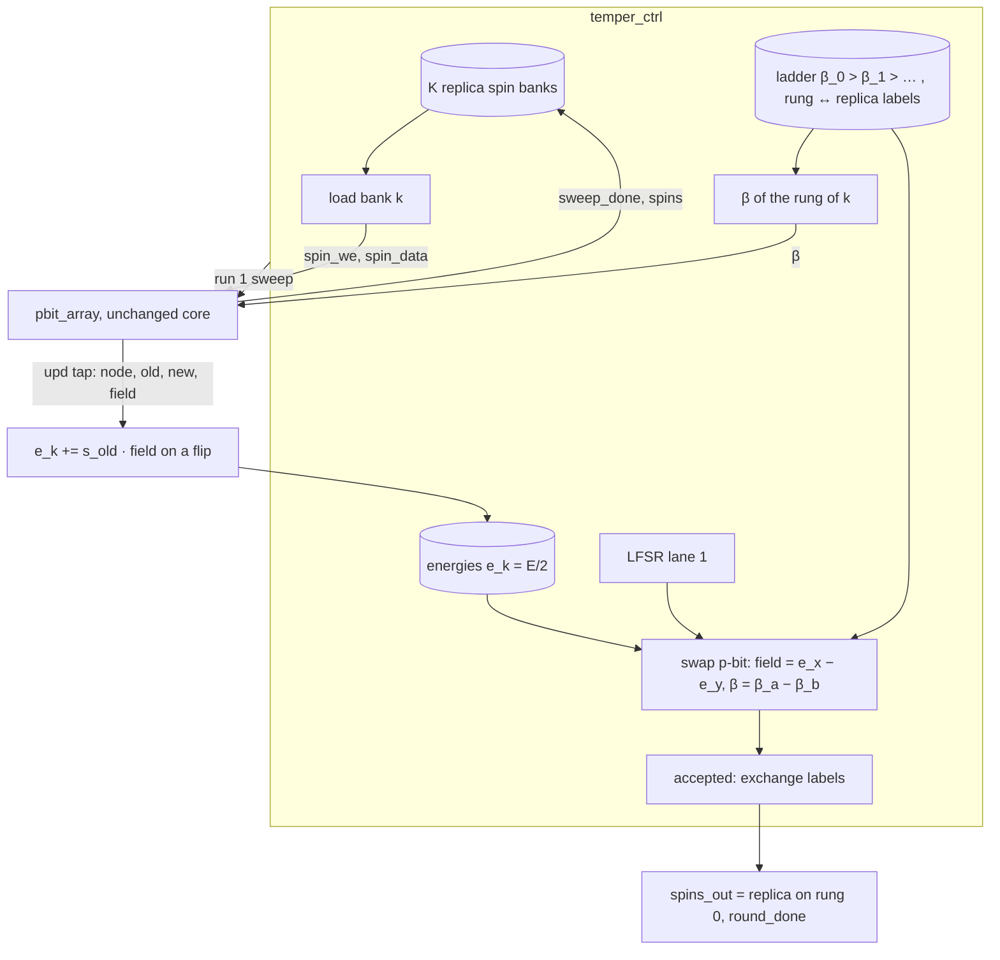
*Caption:* one round = K sweeps (replica k at the β of its rung), then swaps of rung pairs (0,1),(2,3) on even rounds and (1,2) on odd rounds. [FPGA-APPROX] the swap is a Barker test, P = σ(2Δβ·Δe), evaluated by an ordinary `pbit` instance; energies are relative to the common start state, so `resync` is needed after h/J change. Mirror: `model/tempering.py`.

## D14. Continuous p-mode array — `pmode_array.v` (added 2026-10-30)

```mermaid
flowchart LR
  X[(x_i Q4.12)] --> T[tanh via sigmoid LUT: s = 2σ(2x) − 1]
  T --> S[(s_j Q.15)]
  A[(A_ij, h_i Q3.4)] --> MAC[F_i = h_i + Σ_j A_ij s_j]
  S --> MAC
  MAC --> CPL["(1 − s_i²) · F_i"]
  X --> QRT["λ x_i (x_i² − 1)"]
  CPL --> G[grad = quartic − coupling]
  QRT --> G
  NB[noise lane 0] --> GL[Gaussian inverse-CDF LUT] --> NZ["√(2Tε) · ξ"]
  G --> UPD["x' = sat(x − grad >> k + noise)"]
  NZ --> UPD
  UPD --> SH[(shadow x')] -- commit after all sites --> X
```
*Caption:* [DOCUMENTED] the soft-spin energy and the ULA update [torx/helpers/_langevin.py:L46-143]; continuous pmodes [SDP p.21], double-well neurons [BP p.3-6]. [FPGA-APPROX] fixed point, LUT tanh, discrete Gaussian, ε = 2^−k, no Metropolis step. Mirror: `model/pmode.py`.

## D15. Noise path options — `sparse_array.v` NOISE_CTL, raw lane in `top.v` (added 2026-10-30)

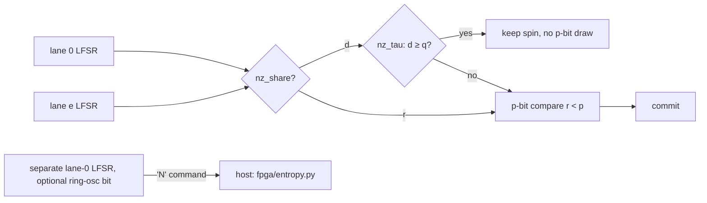
*Caption:* [DOCUMENTED motivation] RNG decorrelation time τ0 [DTM p.6 Fig. 4b]; min-entropy estimates before claiming physical randomness [DF p.76]. [FPGA-APPROX] q = probability that the RNG has decorrelated per update; shared mode = fully correlated lanes. Results: docs/06 §8.
