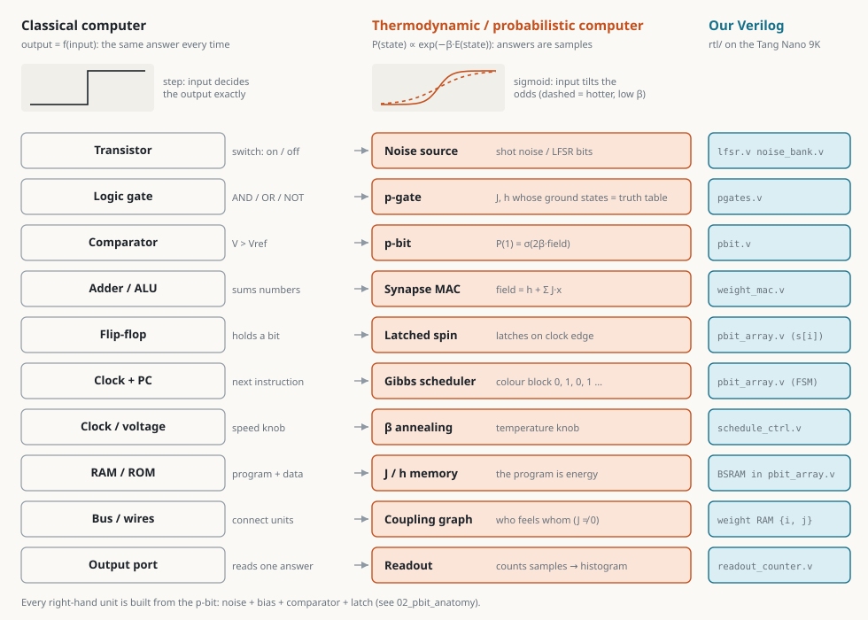
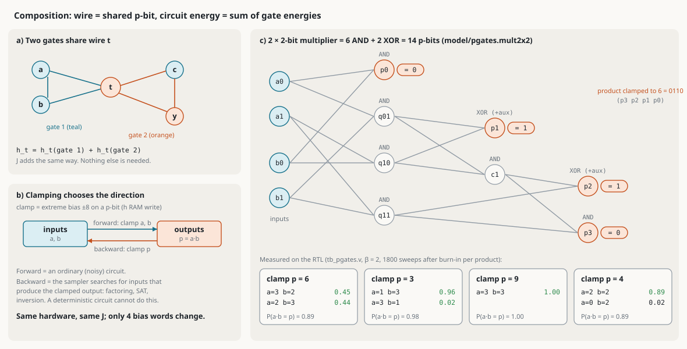
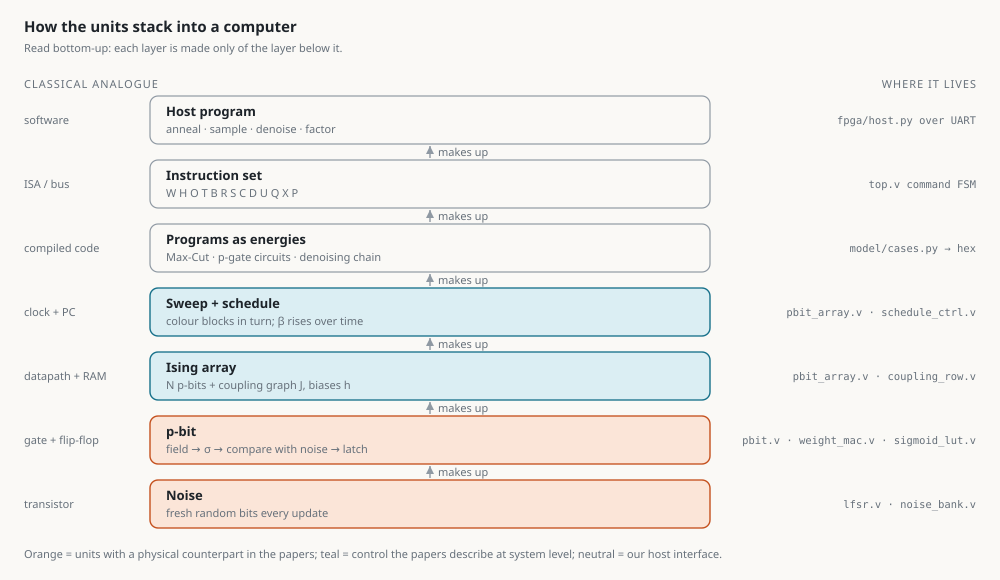
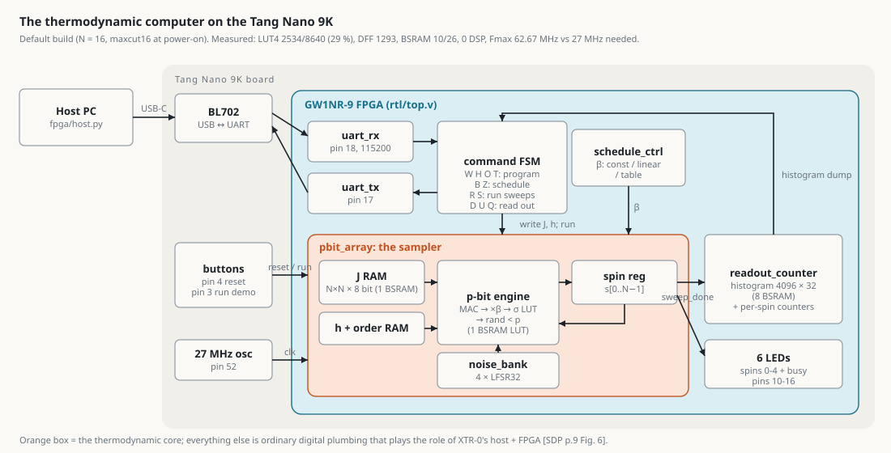

# 04 — Basic units, in pictures

This file answers the first question in `task.md`: *"In normal computing the basic units are AND/OR/NOT gates, ALUs and flip-flops. What are they in thermodynamic computing, and how do they connect?"* It is the picture version of the table in `docs/02_building_blocks.md`.

Colour code in every drawing: **orange** is the physical, thermodynamic side (what the papers describe), **teal** is our digital FPGA emulation (the Verilog in `rtl/`), and **green/grey** mark valid and invalid truth-table rows. The drawings are generated by `tools/make_diagrams.py` from the model code and the measured results, so the numbers in them are not hand-typed. They follow light and dark mode. For an interactive version (p-bit and gate playgrounds, factoring and annealing animations), open `docs/explainer.html`.

Tags as in the README: [DOCUMENTED], [INFERRED], [FPGA-APPROX], [NOT IN SOURCES]. Paper short names as in `docs/01_evidence.md`.

---

## 1. Classical block → thermodynamic block

A classical computer is built so that every block gives the same answer every time. Noise is an enemy, and the step curve at the top left shows this. A thermodynamic (probabilistic) computer is built so that every block gives a *random* answer whose odds are set by an energy, P(state) ∝ exp(−β·E) [DOCUMENTED, DTM p.5 Eq. 10]. Noise is the fuel, and the input only tilts the sigmoid at the top right.

Each row is one classical block, its thermodynamic counterpart, and the Verilog file that emulates it on the Tang Nano 9K. Three points matter most:
- **There is one primitive, the p-bit.** The p-gate, the synapse, the latch and the comparator are parts of it or groups of it. This is why section 2 opens up a single p-bit.
- **The program is an energy function.** Instead of instructions, you load couplings J and biases h. The machine then samples low-energy states. "RAM" holds the energy, not a list of steps.
- **The answer is a histogram.** You do not read one output. You count samples: readout = drawing samples, then histograms or expectations [DOCUMENTED, torx/04_execution_interface_readouts.py:L98-118].

## 2. Inside one p-bit, the "transistor + gate + flip-flop" of thermal computing

The same five stages appear in the physical cell and in our emulation, aligned column by column:

| Stage | Physical cell [DTM p.25 Fig. 10; p.37-38 App. K] | FPGA (`rtl/`) |
|---|---|---|
| 1 inputs | neighbour states x_j on wires | spin register `s[]` + J row from BSRAM |
| 2 weigh + sum | XOR with sign bit s_j, resistor G_j, summed on node V_b [DOCUMENTED] | `weight_mac.v`: acc ± J_ij, one term per clock, no multiplier [FPGA-APPROX] |
| 3 to probability | the bias voltage shifts Gaussian shot noise [DOCUMENTED] | `pbit.v`: ×β by shift-add, then a 1024-entry σ table [FPGA-APPROX] |
| 4 random decision | comparator: noise > threshold [DOCUMENTED] | `rand16 < p16`, rand16 from an LFSR [FPGA-APPROX] |
| 5 hold + broadcast | latch on the clock, wired to the neighbours [DOCUMENTED] | `s[i] ← bit`, read by the next update's MAC |

Stages 3 and 4 together give P(x_i = 1) = σ(2β(Σ_j J_ij x_j + h_i)) [DOCUMENTED, DTM p.5 Eq. 11]. In a classical gate, stage 4 does not exist. In a p-bit, stage 4 is what makes it compute.

## 3. p-gates: AND / OR / NOT / XOR made of p-bits

A p-gate is a handful of p-bits whose J and h are chosen so that **the rows of the truth table are exactly the lowest-energy states**. Left alone, the sampler spends most of its time on valid rows. The tables show the exact Boltzmann probabilities: at β = 1, p-AND sits on one of its 4 valid rows 98.6 % of the time. Raising β pushes that toward 100 %.

- p-NOT is a single negative coupling (J = −1): the two p-bits prefer to disagree.
- p-AND needs 3 p-bits: J_AB = −1, J_AY = J_BY = +2, h = (+1, +1, −2). Every valid row has energy −3 and every invalid row ≥ +1.
- p-OR is p-AND with all biases negated (flipping every spin turns AND into OR).
- p-XOR cannot be made from 3 p-bits with pairwise couplings. It needs one hidden auxiliary p-bit X. The coefficients were found by brute force over integers in [−2, 2] (`model/pgates.check_xor`).

The papers say only that "AND, OR, NOT" can be built by composing energy functions [DOCUMENTED, BP p.3]. They give no coefficients. These are the standard Ising gadgets [NOT IN SOURCES]. They run as real hardware in `rtl/pgates.v` (docs/05).

## 4. How units connect: composition and running backwards

**Connecting gates (a).** In a classical circuit, a wire carries a value from one gate to the next. Here, a wire is **one p-bit shared by both gates**, and the circuit energy is the sum of the gate energies: the J and h of every gate add up. That is the whole composition rule [INFERRED from additive energies, DTM p.5 Eq. 10]. `model/pgates.Circuit.add()` implements it in a few lines.

**Direction is a choice (b).** Pinning a p-bit with an extreme bias ("clamping") fixes its value. Clamp the inputs and the circuit runs forward like an ordinary, slightly noisy circuit. Clamp the **output** and the sampler searches for inputs consistent with it: the circuit runs **backwards**. Nothing in the hardware changes except a few bias words. Clamping = bias offset is [INFERRED] from the denoising chain (docs/02 §2.3).

**A circuit that factors (c).** Six p-ANDs and two p-XORs (14 p-bits) form a 2×2-bit multiplier. With the product clamped to 6, the RTL finds a·b = 6 in 89 % of sweeps: 3×2 and 2×3, about equally often. Clamped to 9 it finds 3×3 every time. The measured boxes come from `tb/tb_pgates.v`. For p = 3 the chain stayed on 1×3 and rarely crossed to 3×1. The two answers are separated by an energy barrier, which is the mixing problem annealing is meant to fight. This is a toy version of the "factorization by programmed heat" idea in `data/` [DOCUMENTED topic, HF; DF], built from p-gates instead of a heat kernel.

## 5. The stack: from noise to a program

Read bottom-up, each layer is made only of the one below it, just as transistors make gates, gates make an ALU, and the ALU runs instructions:
1. **Noise** gives fresh random bits (`lfsr.v`).
2. **p-bit**: a field becomes a probability, then a random bit, then a latched state (`pbit.v`).
3. **Ising array**: N p-bits plus a coupling graph (`pbit_array.v`).
4. **Sweep + schedule**: colour blocks update in turn, and β rises over time (`pbit_array.v`, `schedule_ctrl.v`). This is the clock and program counter of thermal computing [DOCUMENTED, DTM p.5; thrml/03_codon_optimization.py:L322-344].
5. **Programs as energies**: Max-Cut, p-gate circuits and the denoising chain are all just (J, h, β) files (`model/cases.py`).
6. **Instruction set + host**: UART commands load J/h, run sweeps and read histograms (`top.v`, `fpga/host.py`).

## 6. Time: what one update and one sweep cost

Our engine visits one p-bit at a time. Each update takes N + 18 cycles, drawn to scale. Most of that is the MAC over the row (N + 2) and the p-bit stage (12: ×β takes 8, then round, σ and compare). A sweep updates colour 0, then colour 1. Same-colour nodes never touch, so updating them one by one gives exactly the same result as updating them all at once [INFERRED, docs/02 §2.2]. The real chip does each colour phase in parallel in about τ0 ≈ 100 ns [DOCUMENTED, DTM p.5-6]. So the FPGA is roughly 100× slower per sweep, but exact and bit-reproducible.

## 7. The whole machine on the Tang Nano 9K

The orange box is the thermodynamic core: J/h memory, one p-bit engine and the noise bank. Everything around it is ordinary digital plumbing: UART, a command FSM, the β scheduler, histogram counters, LEDs and buttons. Together they play the role of XTR-0's host + FPGA [DOCUMENTED, SDP p.9 Fig. 6]. Utilisation and timing are measured (docs/07). `make case CASE=factor6` in `fpga/` produces a bitstream whose power-on program is the multiplier run backwards. Pressing the run button anneals it, and LEDs 0-3 show a0 a1 b0 b1 (docs/05).
