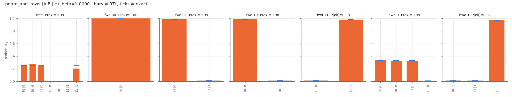
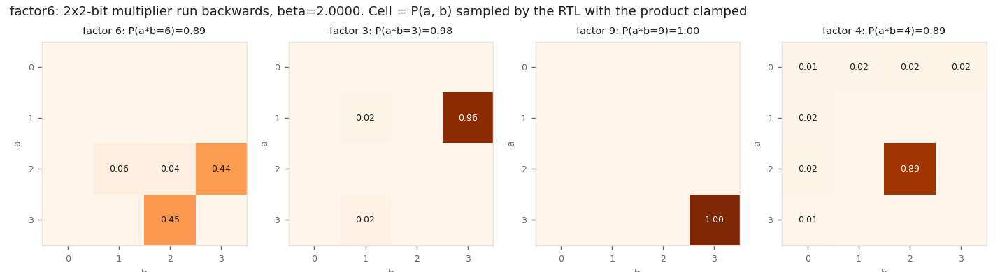

# 05 — p-gates: AND / OR / NOT / XOR on p-bits, composed, and run backwards

Pictures: `docs/04_basic_units.md` §3-4 (`img/units/03_pgates.svg`, `img/units/04_composition.svg`). Interactive: `docs/explainer.html` (gate lab and factoring sections).

## 1. Idea

The answer to "what is the AND gate of a thermodynamic computer" has two parts:
- The **primitive** is the p-bit [DOCUMENTED, DTM p.5 Eq. 11; docs/02].
- A **Boolean gate** is a small group of p-bits whose energy E(s) = −Σ_{i<j} J_ij s_i s_j − Σ_i h_i s_i [DOCUMENTED, DTM p.5 Eq. 10] has the gate's truth-table rows as its lowest-energy states. Sampling P ∝ exp(−βE) then spends most of its time on valid rows.

The papers say this is possible ("logical AND/OR/NOT" by composing energy functions [DOCUMENTED, BP p.3]). They do not give coefficients, so the gadgets below are ours [NOT IN SOURCES]. They are the standard Ising gadgets, and XOR was found by brute force.

| gate | p-bits | J | h | valid-row energy / lowest invalid |
|---|---|---|---|---|
| COPY | A, Y | J_AY = +1 | 0 | −1 / +1 |
| NOT | A, Y | J_AY = −1 | 0 | −1 / +1 |
| AND | A, B, Y | J_AB = −1, J_AY = J_BY = +2 | (+1, +1, −2) | −3 / +1 |
| OR | A, B, Y | same as AND | (−1, −1, +2) | −3 / +1 |
| XOR | A, B, Y, X(aux) | J_AB = J_AY = J_BY = −1, J_·X = −2 | (−1, −1, −1, −2) | −7 / −5 |

`model/pgates.check_gates()` enumerates all states and asserts that the ground states are exactly the truth table. It does this for every gate, the full adder and the 2×2 multiplier. Bit 1 = spin +1.

**Composition rule.** A wire shared by two gates is one p-bit, and J and h of all gates add (`Circuit.add`). This is all that is needed to build:
- a full adder (2 XOR + 2 AND + 1 OR, 10 p-bits);
- a 2×2-bit multiplier (6 AND + 2 XOR, 14 p-bits): p0 = a0b0, p1 = a0b1 ⊕ a1b0, c1 = a0b1·a1b0, p2 = a1b1 ⊕ c1, p3 = a1b1·c1.

**Clamping.** A clamped p-bit gets the extreme bias of the 8-bit word (+127/16 or −128/16). Every terminal has Σ_j|J_ij| ≤ 6, so its field never changes sign. Clamping the inputs runs the circuit forward. Clamping the outputs runs it **backward**: the sampler finds inputs consistent with the output. For the multiplier, that means factoring. Clamping = bias offset is [INFERRED], as for the denoising chain (docs/02 §2.3).

## 2. Hardware

- `rtl/pgates.v`, module `pgate`: wraps `pbit_array` (core unchanged). `start` latches `clamp_mask`/`clamp_val`, rewrites the bias RAM in N cycles (h_i = clamped ? ±max : h0_i), then runs `n_sweeps` sweeps. The spins keep their state between runs, like the hardware. [FPGA-APPROX]
- The cases `pgate_not`, `pgate_and`, `pgate_or`, `pgate_xor`, `fulladder` and `factor6` (`model/cases.py`) are ordinary array cases. They also run through the existing `tb_pbit_array.v` (`make test`) and over UART on the board (`host.py pgate`).
- `fpga/case_wrapper.py` + `make case CASE=factor6` builds a bitstream whose **power-on program is the multiplier with the product clamped to 6**, with β annealed 0.5 → 2 over 128 sweeps (16 steps × 8). The run button runs 256 sweeps, and LEDs 0-3 show a0 a1 b0 b1. In the bit-exact Python mirror, 178 of 200 successive button presses end on a·b = 6 (`fixed.FixedSampler`, schedule reset per press, state kept).

Board build, real P&R (`make case CASE=factor6`):
```
Info: 	                LUT4:    2405/   8640    27%
Info: 	                 ALU:     932/   6480    14%
Info: 	                 DFF:    1224/   6480    18%
Info: 	               BSRAM:      10/     26    38%
Info: Max frequency for clock 'top_inst.clk': 69.46 MHz (PASS at 27.00 MHz)
```
The bitstream `fpga/build/case_factor6.fs` was produced. **It was not flashed, because no board was attached.**

## 3. Verification (`cd tb && make pgates`, run 2026-10-25)

For each case, `tb_pgates.v` plays a clamp script: free run, every input row forward, every output row backward, or, for factor6, the products 6, 3, 9 and 4. It runs 2000 sweeps per scenario (4000 for factor6), checks every post-sweep state against `model/fixed.py` bit for bit, and dumps the spins. `compare.py --pgates` drops 200 burn-in sweeps per scenario, then compares the (inputs | outputs) row law with the **exact stationary law of the quantized kernel** (`fixed.fixed_stationary`).

```
tb_pgates[../model/vectors/pgate_not/]: N=2, 5 scenarios, 10000 sweeps, bit-exact vs fixed.py: 0 mismatches
tb_pgates[../model/vectors/pgate_and/]: N=3, 7 scenarios, 14000 sweeps, bit-exact vs fixed.py: 0 mismatches
tb_pgates[../model/vectors/pgate_or/]: N=3, 7 scenarios, 14000 sweeps, bit-exact vs fixed.py: 0 mismatches
tb_pgates[../model/vectors/pgate_xor/]: N=4, 7 scenarios, 14000 sweeps, bit-exact vs fixed.py: 0 mismatches
tb_pgates[../model/vectors/fulladder/]: N=10, 13 scenarios, 26000 sweeps, bit-exact vs fixed.py: 0 mismatches
tb_pgates[../model/vectors/factor6/]: N=14, 4 scenarios, 16000 sweeps, bit-exact vs fixed.py: 0 mismatches
```
pgate_not  rows = (A | Y)  beta = 1.0000
  scenario     P(ok) RTL P(ok) exact      TV  most likely row   check
  free            0.8878      0.8808  0.0240  0|1             ok
  fwd 0           0.8933      0.8808  0.0125  0|1             ok
  fwd 1           0.8750      0.8808  0.0058  1|0             ok
  bwd 0           0.8789      0.8808  0.0019  1|0             ok
  bwd 1           0.8894      0.8808  0.0087  0|1             ok
pgate_and  rows = (A,B | Y)  beta = 1.0000
  scenario     P(ok) RTL P(ok) exact      TV  most likely row   check
  free            0.9906      0.9864  0.0495  10|0             ok
  fwd 00          1.0000      1.0000  0.0000  00|0             ok
  fwd 01          0.9878      0.9820  0.0058  01|0             ok
  fwd 10          0.9844      0.9820  0.0024  10|0             ok
  fwd 11          0.9800      0.9820  0.0020  11|1             ok
  bwd 0           0.9944      0.9939  0.0076  00|0             ok
  bwd 1           0.9689      0.9646  0.0043  11|1             ok
pgate_or  rows = (A,B | Y)  beta = 1.0000
  scenario     P(ok) RTL P(ok) exact      TV  most likely row   check
  free            0.9883      0.9864  0.0561  00|0             ok
  fwd 00          0.9778      0.9820  0.0042  00|0             ok
  fwd 01          0.9844      0.9820  0.0024  01|1             ok
  fwd 10          0.9800      0.9820  0.0020  10|1             ok
  fwd 11          1.0000      1.0000  0.0000  11|1             ok
  bwd 0           0.9639      0.9646  0.0029  00|0             ok
  bwd 1           0.9933      0.9939  0.0241  10|1             ok
pgate_xor  rows = (A,B | Y)  beta = 1.5000
  scenario     P(ok) RTL P(ok) exact      TV  most likely row   check
  free            0.9233      0.9199  0.0489  01|1             ok
  fwd 00          0.8972      0.9094  0.0122  00|0             ok
  fwd 01          0.8922      0.9094  0.0172  01|1             ok
  fwd 10          0.9228      0.9094  0.0133  10|1             ok
  fwd 11          0.9578      0.9525  0.0052  11|0             ok
  bwd 0           0.9028      0.9094  0.0280  11|0             ok
  bwd 1           0.9161      0.9305  0.0391  01|1             ok
fulladder  rows = (a,b,cin | s,cout)  beta = 1.5000
  scenario     P(ok) RTL P(ok) exact      TV  most likely row   check
  free            0.8461      0.8455  0.2099  110|01            ok
  fwd 000         0.8467      0.8330  0.0137  000|00            ok
  fwd 001         0.9017      0.8267  0.0883  001|10            ok
  fwd 010         0.8200      0.8294  0.0104  010|10            ok
  fwd 011         0.7989      0.8576  0.0621  011|01            ok
  fwd 100         0.8656      0.8294  0.0373  100|10            ok
  fwd 101         0.9522      0.8576  0.0946  101|01            ok
  fwd 110         0.8494      0.8661  0.0168  110|01            ok
  fwd 111         0.8911      0.8661  0.0250  111|11            ok
  bwd 00          0.6706      0.6543  0.0287  000|00            ok
  bwd 01          0.9350      0.9217  0.0872  110|01            ok
  bwd 10          0.8611      0.8820  0.0915  001|10            ok
  bwd 11          0.7483      0.7840  0.0462  111|11            ok
factor6  rows = (a0,a1,b0,b1 | p0,p1,p2,p3)  beta = 2.0000
  scenario     P(ok) RTL P(ok) exact      TV  most likely row   check
  factor 6        0.8937      0.9385  0.0641  1101|0110          ok
  factor 3        0.9808      0.9799  0.4694  1011|1100          ok
  factor 9        1.0000      0.9998  0.0002  1111|1001          ok
  factor 4        0.8903      0.7480  0.1423  0101|0010          ok
columns: P(ok) = probability of rows consistent with the gate and the clamp; exact = stationary law of the quantized kernel; TV = RTL vs exact over (inputs|outputs) rows
pgates: PASS
```

```

Row strings list the wires in the order shown in the header, lowest bit first. For factor6, `1101|0110` means a0=1, a1=1 (a = 3), b0=0, b1=1 (b = 2), and p = 0110 read as p0 p1 p2 p3 = 6. P(ok) is the probability of rows consistent with the gate *and* the clamp.

Plots: `img/pgate_and.png`, `img/pgate_xor.png`, `img/pgate_fulladder.png`, `img/pgate_factor6.png` (bars = RTL, ticks = exact).




### Reading the numbers
- **Every logic check passes.** Forward, the most likely output is the truth table's output. Backward, the most likely inputs are a pre-image, with P(ok) > 0.5.
- **The gates match the exact law.** For NOT/AND/OR/XOR, TV is 0.002-0.06 with 1800 samples per scenario. The free-running rows (TV ≈ 0.05) wander more, because the chain moves slowly between valid rows.
- **The bigger circuits mix slowly.** The full-adder free run has TV 0.21 because the chain moves slowly between its 8 valid rows. P(valid) still matches (0.846 vs 0.846). For factor 3, the RTL found 1×3 and stayed there (0.96). The other answer, 3×1, sits behind an energy barrier, so TV vs the exact law (which splits 50/50) is 0.47. This is the mixing problem that annealing, parallel tempering and more sweeps address. It is a property of the circuit's energy landscape, not a hardware error: the run is bit-exact with the model.
- **Parallel tempering fixes factor 3** (added 2026-10-30, docs/06 §9). `pgate` with K = 4 replicas (`temper_ctrl.v`, β = 2, 1.25, 0.75, 0.375), case `factor6_pt`, runs the same script with the same sweep budget, bit-exact with `model/tempering.py`. Factor 3 TV vs exact drops from 0.47 to 0.065, because the cold replica now visits both 1×3 and 3×1. Factor 6 goes from 0.064 to 0.044 and factor 4 from 0.142 to 0.102. Board image: `make case CASE=factor6_pt` (docs/07).
- **Gate errors are thermal.** P(ok) < 1 at finite β is not noise in the electronics but the Boltzmann weight of invalid rows: e^(−β·gap). Raising β trades accuracy against mixing speed. For factor6, the exact quantized law gives P(a·b = 6) = 0.571 at β = 1, 0.938 at β = 2 and 0.941 at β = 3. Meanwhile, the median number of sweeps to the first correct answer grows from 20 to 71 to 609 (Python mirror, 50 runs each). β = 2 is the chosen compromise.

## 4. Limits
- The coefficients are ours [NOT IN SOURCES]. Neither the DTM nor the X0/Z1 papers show a gate-level energy gadget.
- Larger circuits need larger |J|, |h| on shared wires. The full adder reaches Σ|J| = 11 on one node, still inside Q3.4. A deeper circuit would need weight scaling or a wider format.
- Backward search on bigger problems (factoring beyond 2 bits) quickly becomes a hard sampling problem. The diffusion-factorization monograph in data/ makes the same point about its own approach: "a verification platform, not a fast large-integer factoring machine" [DOCUMENTED, DF p.71].
