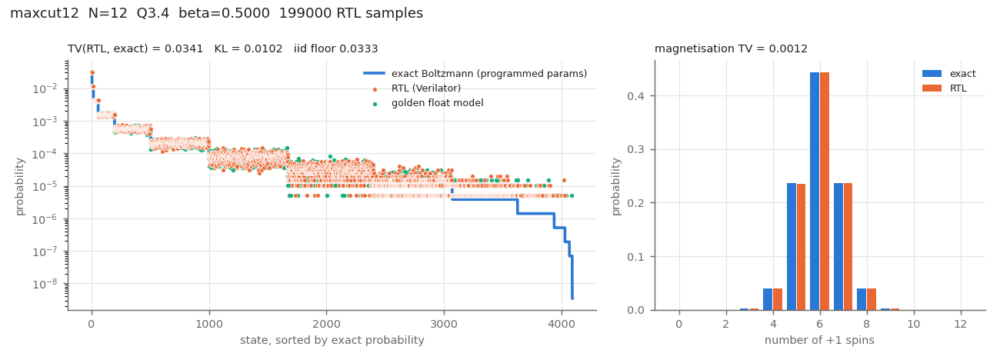

# 06 — Verification

Everything below was produced by commands run in this repository on 2026-10-23 and pasted verbatim (only the long iverilog command echoes are trimmed).

Tools (OSS CAD Suite 2026-10-23, installed in `~/tools/oss-cad-suite`, no sudo):
```
Icarus Verilog version 14.0 (devel) (s20260301-649-g1a663cb33-dirty)
Verilator 5.053 devel rev v5.052-555-g043f7aa51 (mod)
Yosys 0.70+201 (git sha1 0ad867ab5, Release, Clang /usr/bin/clang++ 21.1.8)
```

## What is checked, and against what

| Level | Testbench | Reference | Criterion |
|---|---|---|---|
| noise | `tb/tb_noise_bank.v` | `model/fixed.lfsr_draw16` (4 lanes × 256 draws) | bit-exact |
| sigmoid | `tb/tb_sigmoid.v` | LUT file + `fixed.sigmoid_pwl` (all 1024 logits) | bit-exact, monotone |
| MAC | `tb/tb_weight_mac.v` | 512 random rows | bit-exact |
| p-bit | `tb/tb_pbit.v` | 4096 random (field, β, rnd) | logit, p and bit exact |
| schedule | `tb/tb_schedule_ctrl.v` | `fixed.Schedule`, 3 modes × 64 sweeps | exact |
| readout | `tb/tb_readout_counter.v` | testbench reference model | exact |
| UART | `tb/tb_uart.v` | loopback at 27 MHz / 115200 | 256 bytes |
| **array** | `tb/tb_pbit_array.v` × 5 cases + PWL | `fixed.FixedSampler` | spin state after every sweep, bit-exact |
| **statistics** | Verilator, 200,000 sweeps per case | (a) exact Boltzmann by enumeration of all 2^N states, (b) golden float model, (c) exact stationary law of the quantized kernel | TV, KL; the full 200,000-sweep trace must also be bit-exact |
| **top** | `tb/tb_top.v` (UART only) | Python replay of the whole session | byte-for-byte |
| **denoise** | `tb/tb_denoise.v` | `model/denoise.py` | bit-exact per step |

The cases come from `model/cases.py`:
- `ring8` / `ring8_q6`: the 8-site ring of torx/06 (J, h, β = 1.5) [torx/06_ising_sampling_contrastive_divergence.py:L203-208], quantized to Q3.4 and Q1.6.
- `maxcut12` and `maxcut16`: random 3-regular Max-Cut graphs with J = −1 [torx/helpers/_nb09_maxcut.py:L31-44].
- `grid16`: the 4×4 periodic ferromagnet of torx/16 [torx/16_gibbs_sampling_factor_graph.py:L136-145]. Its β = 0.45 is not representable in Q4.4, so it becomes 0.4375.

## 1. `make test` (unit + bit-exact arrays + lint)

```
ring8     N= 8 Q3.4 beta_q= 24 (1.5000) mode=0 colours=2 order=[0, 2, 4, 6, 1, 3, 5, 7]
ring8_q6  N= 8 Q1.6 beta_q= 24 (1.5000) mode=0 colours=2 order=[0, 2, 4, 6, 1, 3, 5, 7]
maxcut12  N=12 Q3.4 beta_q=  8 (0.5000) mode=0 colours=3 order=[0, 1, 5, 11, 2, 3, 6, 9, 4, 7, 8, 10]
grid16    N=16 Q3.4 beta_q=  7 (0.4375) mode=0 colours=2 order=[0, 2, 5, 7, 8, 10, 13, 15, 1, 3, 4, 6, 9, 11, 12, 14]
maxcut16  N=16 Q3.4 beta_q=  8 (0.5000) mode=2 colours=4 order=[0, 2, 3, 4, 10, 13, 1, 5, 6, 8, 12, 7, 9, 11, 14, 15]
tb_noise_bank: 4 lanes x 256 draws checked, reseed replay  ok, lane0/lane1 bit0 agreement 120/256
tb_noise_bank: PASS
tb_sigmoid: LUT[0]=0 LUT[512]=32768 LUT[1023]=65535, non-monotone steps=0, max|PWL-LUT|=1241/65536
tb_sigmoid: PASS
tb_weight_mac: 512 rows, N=8, start->done = 10 cycles
tb_weight_mac: PASS
tb_pbit: 4096 updates, start->done = 12 cycles, ones = 2071
tb_pbit: PASS
tb_schedule_ctrl: 3 modes x 64 sweeps, final linear beta=40 table beta=137
tb_schedule_ctrl: PASS
tb_readout_counter: 5000 samples, n_samples=5000, hist[0xA5]=344, errors after counting=0
tb_readout_counter: PASS
tb_uart: 256 bytes looped back, 0 errors
tb_uart: PASS
tb_pbit_array[../model/vectors/ring8/]: N=8, 2000 sweeps, 208 cycles/sweep, bit-exact over first 2000 sweeps: 0 mismatches
tb_pbit_array: PASS
tb_pbit_array[../model/vectors/ring8_q6/]: N=8, 2000 sweeps, 208 cycles/sweep, bit-exact over first 2000 sweeps: 0 mismatches
tb_pbit_array: PASS
tb_pbit_array[../model/vectors/maxcut12/]: N=12, 2000 sweeps, 360 cycles/sweep, bit-exact over first 2000 sweeps: 0 mismatches
tb_pbit_array: PASS
tb_pbit_array[../model/vectors/grid16/]: N=16, 2000 sweeps, 544 cycles/sweep, bit-exact over first 2000 sweeps: 0 mismatches
tb_pbit_array: PASS
tb_pbit_array[../model/vectors/maxcut16/]: N=16, 2000 sweeps, 544 cycles/sweep, bit-exact over first 2000 sweeps: 0 mismatches
tb_pbit_array: PASS
tb_pbit_array[../model/vectors/ring8/ PWL]: N=8, 2000 sweeps, 208 cycles/sweep, bit-exact over first 2000 sweeps: 0 mismatches
tb_pbit_array: PASS
lint: top.v hierarchy clean (verilator -Wall)
```
`maxcut16` uses the annealing table (mode 2), so the β schedule is covered by the bit-exact check too. Lint is clean at `-Wall`. The waivers are DECLFILENAME, UNUSEDSIGNAL, UNUSEDPARAM and PROCASSINIT; the last is waived because the coding style mandates declaration initializers. Lint also passes at N = 32, 64 and 128.

**Cycle cost [FPGA-APPROX]:** N + 18 cycles per p-bit update and N·(N+18) per sweep: 208 for N=8, 544 for N=16. At 27 MHz, a 16-p-bit sweep takes 20.1 µs (~49,600 sweeps/s).

## 2. `make stats` — histograms vs exact Boltzmann (200,000 sweeps, 1000 burn-in)

```
tb_pbit_array[../model/vectors/ring8/]: N=8, 200000 sweeps, 208 cycles/sweep, bit-exact over first 2000 sweeps: 0 mismatches
tb_pbit_array[../model/vectors/ring8_q6/]: N=8, 200000 sweeps, 208 cycles/sweep, bit-exact over first 2000 sweeps: 0 mismatches
tb_pbit_array[../model/vectors/maxcut12/]: N=12, 200000 sweeps, 360 cycles/sweep, bit-exact over first 2000 sweeps: 0 mismatches
tb_pbit_array[../model/vectors/grid16/]: N=16, 200000 sweeps, 544 cycles/sweep, bit-exact over first 2000 sweeps: 0 mismatches
/usr/bin/python3 compare.py --sweeps 200000 --cases ring8 ring8_q6 maxcut12 grid16 --out build/stats.json
case      fmt    samples  trace TV rtl/exact       KL TV rtl/fxstat TV rtl/golden TV gold/exact TV iid floor TV quant  TV mag
ring8     Q3.4   199000      0       0.0092   0.0007        0.0092        0.0136        0.0097       0.0085   0.0534  0.0014
ring8_q6  Q1.6   199000      0       0.0106   0.0007        0.0087        0.0132        0.0090       0.0097   0.0130  0.0028
maxcut12  Q3.4   199000      0       0.0341   0.0102        0.0341        0.0474        0.0356       0.0333   0.0000  0.0012
grid16    Q3.4   199000      0       0.0560   0.0666        0.0560        0.0673        0.0519       0.0522   0.0417  0.0073
columns: trace = RTL vs fixed.py post-sweep mismatches over the whole run; TV quant = exact(quantized params) vs exact(original float params); TV mag = magnetisation-distribution TV
compare: PASS (all RTL traces bit-exact)
```

How to read the columns:
- **trace = 0**: the RTL and `model/fixed.py` agree on all 200,000 post-sweep states of every case. This makes the RTL a verified implementation of the fixed-point specification.
- **TV rtl/exact ≈ TV iid floor**: "iid floor" is the TV of 199,000 *independent* draws from the exact law. The RTL histogram is as close to exact Boltzmann as perfect iid sampling would be, within Monte-Carlo noise. Sweeps are autocorrelated, so the small excess (for example 0.0106 vs 0.0097) is expected. grid16 has 65,536 states for 199,000 samples, so its full-state TV is noise-dominated; its 17-bin magnetisation TV is 0.0073.
- **TV rtl/golden**: compares the RTL against the float golden model. That model is itself a Monte-Carlo estimate, so this value is roughly the two noise floors added (golden vs exact is shown next to it).
- **TV quant**: how far the *programmed* model is from the source's float model, caused purely by weight quantization. Q3.4 rounds torx/06's J = 0.65 to 0.625 and shifts the ring's law by TV 0.053. **Q1.6 reduces that to 0.013.** This is why the weight fraction bits are a parameter (`WFRAC`).
- The exact stationary law of the quantized kernel differs from exact Boltzmann by TV 2×10⁻⁵ (ring8) and 1×10⁻⁵ (maxcut12), computed separately with `model/fixed.fixed_stationary`. So the 16-bit LUT sigmoid and the rounding add no visible bias; any remaining error comes from J/h quantization.

Plots (`tb/plot_hist.py`): `docs/img/hist_ring8.png`, `docs/img/hist_ring8_q6.png`, `docs/img/hist_maxcut12.png`, `docs/img/hist_grid16.png`.



## 3. `make top` — end-to-end over UART

```
tb_top: 16767 bytes received over UART, button run observed busy=1
tb_top: byte stream written to build/top_uart_dump.txt (checked by compare.py --top-dump)
/usr/bin/python3 compare.py --top-dump build/top_uart_dump.txt
top UART replay: received 16767 bytes, expected 16767, mismatching bytes: 0
  ping reply N=16 HIST_BITS=12; final spins 0x0000; samples counted 2000+5+128
compare --top-dump: PASS
```
The session: boot with maxcut16, then reprogram to grid16 (256 W + 16 H + 16 O), then B, X, C, R 2000, U, Q, S 5, D (4096 bins), button S2, Q, and an unknown command. Every returned byte equals the Python replay. This run uses a fast baud (8 clocks/bit) for simulation speed. The real 234-clock bit time is covered by `tb_uart`.

## 4. `make denoise` — DTM-style denoising chain

```
denoise: N=16 T=4 K=16 beta=1.0 Gamma_t/2 (Q3.4) per step t=1..T: [17, 11, 8, 6] = [1.0625, 0.6875, 0.5, 0.375]
denoise: 2000 chains from uniform x^T: x^0 within Hamming 1 of a stored pattern (or its negation) in 96.0% (exact 90.2%); uniform random baseline 0.1%
run 0 x^T=676b x^0=0660 : .... .##. .##. ....
run 1 x^T=6179 x^0=6996 : .##. #..# #..# .##.
run 2 x^T=3338 x^0=33cc : ..## ..## ##.. ##..
run 3 x^T=9974 x^0=33cc : ..## ..## ##.. ##..
run 4 x^T=2dc5 x^0=6996 : .##. #..# #..# .##.
run 5 x^T=3af2 x^0=6996 : .##. #..# #..# .##.
run 6 x^T=3f99 x^0=6996 : .##. #..# #..# .##.
run 7 x^T=221c x^0=33cc : ..## ..## ##.. ##..
tb_denoise: PASS (8 chains x 4 steps bit-exact)
```
The outputs are the stored patterns' **negations** in these 8 runs. With zero field, a Hebbian energy is symmetric under s → −s [INFERRED from Eq. 10 with h = 0]. This is a property of our hand-set weights, not of DTM.

## 5. Max-Cut annealing (`compare.py --anneal`, Python mirror of the bit-exact RTL)

```
maxcut16: |E|=24, brute-force optimum cut = 20 (18 optimal states of 65536)
  200 anneal runs (128 sweeps beta 0.25->4.00 + 32 at max): final state optimal in 96.0% of runs, best-seen optimal in 100.0%, mean final cut 19.96
  reference: mean cut of a uniformly random partition = 12.00
```
The schedule is the geometric β table, mirroring thrml/03's log-spaced schedule [thrml/03_codon_optimization.py:L322-344]. The first 2000 sweeps of this exact run are checked bit-exact against the RTL in §1 (case `maxcut16`).

## 6. Sparse parallel array — `make sparse`, `make stats-sparse`, `make top-sparse` (added 2026-10-29)

**Spec tie-in.** `model/fixed.SparseParallelSampler` with P = 1 and neighbour lists built from the dense J reproduces `FixedSampler` exactly on all 11 dense cases (3000 sweeps each). The new spec therefore inherits the verified one.

**Bit-exact RTL (`make sparse`, part of `make test`).** `tb_sparse_array` vs `SparseParallelSampler`, post-sweep state after every sweep:

| case | N | P | D | rounds | cycles/sweep | cycles/round | mismatches |
|---|---|---|---|---|---|---|---|
| sp_ring8 | 8 | 1 / 2 / 4 | 2 | 8 / 4 / 2 | 144 / 76 / 42 | 18 / 19 / 21 | 0 / 0 / 0 (2000 sweeps) |
| sp_maxcut12 | 12 | 1 / 2 / 4 | 3 | 12 / 6 / 3 | 228 / 120 / 66 | 19 / 20 / 22 | 0 / 0 / 0 |
| sp_grid16 | 16 | 1 / 2 / 4 | 4 | 16 / 8 / 4 | 320 / 168 / 92 | 20 / 21 / 23 | 0 / 0 / 0 |
| sp_g12_ferro16 | 256 | 1 / 4 | 9 | 256 / 64 | 6400 / 1792 | 25 / 28 | 0 / 0 (300 sweeps) |
| sp_g12_glass16 | 256 | 1 / 4 | 9 | 256 / 64 | 6400 / 1792 | 25 / 28 | 0 / 0 |

The cycles per round equal D + P + 15 in every row. The 16 × 16 G12 grid has maximum degree 9, not 12: the (9, 10) rule of DTM Table II mostly falls off a 16-wide grid, and edges leaving the grid are not formed [DTM, p.24]. DTM uses L = 70.

**Statistics (`make stats-sparse`, P = 4, burn-in 1000 resp. 10 %).** The full RTL traces (200,000 resp. 20,000 sweeps) are bit-exact with the model.

| case | sweeps | TV rtl / exact | KL | TV iid floor |
|---|---|---|---|---|
| sp_ring8_p4 | 200,000 | 0.0108 | 0.0007 | 0.0111 |
| sp_maxcut12_p4 | 200,000 | 0.0355 | 0.0106 | 0.0336 |
| sp_grid16_p4 | 200,000 | 0.0584 | 0.0662 | 0.0516 |

For N = 256 there is no exact law. The comparison is against a float chromatic-Gibbs reference with the same programmed parameters (256 independent chains, 3000 sweeps, 1000 burn-in). Errors are batch-means standard errors.

| case | E/N rtl | E/N float ref | ⟨\|m\|⟩ rtl | ⟨\|m\|⟩ float ref |
|---|---|---|---|---|
| sp_g12_ferro16_p4 (J = +0.25, β = 0.5) | −0.1261 ± 0.0004 | −0.1266 ± 0.0002 | 0.1143 ± 0.0011 | 0.1144 ± 0.0004 |
| sp_g12_glass16_p4 (J = ±0.5, β = 1.0) | −0.7816 ± 0.0015 | −0.7814 ± 0.0003 | 0.0437 ± 0.0007 | 0.0438 ± 0.0002 |

All agree within about 1σ. The 4 lanes with distinct polynomials show no bias against the exact law (small cases) or the float reference (large cases).

**End to end (`make top-sparse`).** `top.v` with SPARSE = 1, N = 256, P = 4 and UP_RAM = 1 boots empty. Over UART alone it is programmed with the G12 spin glass (1 `G`, 256 `M`, 1848 `E`), then runs B, X, C, R 300, U, Q, S 3, D, Q and an unknown command. All **19,694/19,694** received bytes equal the Python replay (`compare.py --top-sparse-dump`). The dense `make top` still passes 16,767/16,767.

## 7. Generic UART sessions — `make script` (added 2026-10-30)

`model/uart_script.TopModel` is a byte-level model of the whole `top.v`, dense or SPARSE:
- every command, including the new `Y`, `N` and `L`;
- the RAMs, word for word;
- the schedule, the readout counters, the noise lanes and the tempering controller.

`Script` records a host session together with the reply length the model predicts. `tb/tb_top_script.v` plays any such session over the UART (8 clocks/bit) and dumps every received byte. The check is byte-for-byte equality with the model.

| session | top configuration | sent / received bytes | mismatches |
|---|---|---|---|
| `noise_dense` | default dense build (maxcut16 power-on program, table schedule) | 27 / 688 | 0 |
| `noise_sparse` | SPARSE N = 16, P = 4, NOISE_CTL = 1: program grid16 over G/M/E, then runs with no option, τ0 (q = 1/8), shared noise, and both, plus streaming, readout and `N` | 562 / 16,670 | 0 |
| `temper_dense` | dense, TEMPER_K = 4: multiplier clamped to 3, ladder over `L`, rounds, re-clamp to 6 + `Z` resync, ladder change, readout | 403 / 16,581 | 0 |
| `train_xor_h` | dense default: the first 3 epochs of `model/train.py` (XOR + 1 hidden unit) | 725 / 9,669 | 0 |

The model was written independently of `compare.py do_top`, which is still used by `make top`.

## 8. Noise realism — `make noise` (added 2026-10-30)

**RTL.** `sparse_array.v` with NOISE_CTL = 1 (spec: `fixed.SparseParallelSampler(q16=, share=)`) has two options:
- **RNG persistence (τ0).** Each update first draws d. If d ≥ q, the cell keeps its spin and takes no second draw. This is a lazy Gibbs kernel: the stationary law is the same and the autocorrelation is about (1−q)^t. [DOCUMENTED motivation: DTM p.6 Fig. 4b.]
- **Shared noise.** Every lane uses lane 0's draw, so the cells of one round are fully correlated.

When the options are off the cycle counts are unchanged.

**Bit-exact.** The new cases `sp_ring8_p4_tau`, `sp_grid16_p4_tau`, `sp_grid16_p4_share` and `sp_grid16_p4_tsh` are part of `make sparse`, each with 0 mismatches over 2000 sweeps. The noise options change 75-98 % of the post-sweep states compared with the plain cases. Long Verilator runs of `sp_grid16_p4_tau` and `_share` (200,000 sweeps) equal the model over the **full** run.

**q-scan** (P = 4, 200,000 sweeps, `tb/noise_study.py`). TV is against the exact stationary law of the quantized kernel. The iid floor uses the effective sample size n/(2τ_int), so TV/floor < 1 is expected; the floor is conservative.
```
  case          q  TV exact tau_int(E)  tau*q iid floor TV/floor  <E> rtl <E> exact
  ring8    1.0000    0.0108       0.71   0.71    0.0112     0.97   -2.168    -2.169
  ring8    0.5000    0.0141       1.71   0.86    0.0177     0.80   -2.163    -2.169
  ring8    0.2500    0.0194       3.66   0.92    0.0261     0.74   -2.171    -2.169
  ring8    0.1250    0.0271       8.20   1.02    0.0370     0.73   -2.174    -2.169
  ring8    0.0625    0.0381      16.18   1.01    0.0528     0.72   -2.167    -2.169
  grid16   1.0000    0.0584       1.65   1.65    0.0853     0.69  -24.815   -24.842
  grid16   0.5000    0.0582       4.82   2.41    0.1207     0.48  -24.774   -24.842
  grid16   0.2500    0.0744      11.10   2.77    0.1562     0.48  -24.846   -24.842
  grid16   0.1250    0.1031      22.34   2.79    0.1826     0.56  -24.790   -24.842
  grid16   0.0625    0.1330      46.67   2.92    0.2255     0.59  -24.817   -24.842
```
- **The law does not move.** ⟨E⟩ matches the exact value to within 0.3 % at every q, and TV stays within the effective-sample floor.
- **Mixing slows as 1/q.** τ_int·q is about constant: ≈ 1 for ring8 and ≈ 2.8 for grid16 at small q.

So a slow RNG (τ0 longer than the update period) costs time, not correctness. Plot: `tb/build/noise_tau.png`.

**Shared noise** (same runs):
```
  ring8   P=1  TV 0.0092  iid floor 0.0111  ratio   0.83  <E>  -2.169 vs exact  -2.169
  ring8   P=2  TV 0.2626  iid floor 0.0122  ratio  21.44  <E>  -2.013 vs exact  -2.169
  ring8   P=4  TV 0.3391  iid floor 0.0124  ratio  27.44  <E>  -2.034 vs exact  -2.169
  grid16  P=1  TV 0.0560  iid floor 0.0848  ratio   0.66  <E> -24.816 vs exact -24.842
  grid16  P=2  TV 0.5209  iid floor 0.0783  ratio   6.65  <E> -24.846 vs exact -24.842
  grid16  P=4  TV 0.5268  iid floor 0.0720  ratio   7.32  <E> -26.634 vs exact -24.842
```
With P = 1 sharing is harmless, because each round has one cell. With P ≥ 2, cells updated together see the same draw, which biases the law strongly (ring8 P = 4: TV 0.34, 27× the floor). **Correlated RNGs between cells that update in parallel break the sampler even when the cells are not coupled.** This quantifies the "any linear structure … could alias" concern in docs/08 B1.

**Raw noise and entropy.** The `'N'` command streams draws from a separate lane-0 LFSR, which `X` reseeds. In `noise_dense` the 300 draws equal `fixed.lfsr_draw16` exactly. `fpga/entropy.py` on these 4,800 bits reports:
- P(1) = 0.498 (z = −0.29);
- no autocorrelation lag 1-64 outside the 3/√n band;
- MCV min-entropy 0.94 bit/bit and Markov 0.995 bit/bit;
- byte χ² p = 0.34.

An LFSR passes these tests while having zero true entropy, so they are necessary, not sufficient. The same script is what `host.py entropy` runs on the board for RO_JITTER = 0 vs 1.

## 9. Parallel tempering — `make pgates` (factor6_pt) and `make script` (added 2026-10-30)

**RTL.** `temper_ctrl.v` drives one unchanged `pbit_array` from the side:
- It holds K ≤ 4 replica spin banks, their energies and a β ladder.
- Energies are tracked incrementally from the new `upd_*` tap: e += s_old·field on each flip, with e = E/2. This is exact in integer units, and `tempering._selftest` checks it against the full energy over 300 rounds.
- The swap test is a second p-bit: field = e_x − e_y, β = the ladder gap, accept with σ(2·Δβ·Δe). This Barker acceptance satisfies detailed balance and reuses the sigmoid LUT [FPGA-APPROX]. The draw comes from LFSR lane 1.
- The spec is `model/tempering.py`. `pgates.v` (K) and `top.v` (TEMPER_K, `L`, `Z` resync) instantiate it.

**Bit-exact.** `factor6_pt` (K = 4, β = 2, 1.25, 0.75, 0.375) runs the docs/05 factoring script on products 6, 3, 9 and 4: 4000 rounds = 16,000 replica sweeps plus swaps, with 0 mismatches.

**Mixing at the same sweep budget** (1000 rounds × 4 sweeps vs 4000 sweeps per scenario, 200 rounds/sweeps of burn-in, TV vs `fixed_stationary` at β = 2):
```
                       factor 6   factor 3   factor 9   factor 4
  K = 1 (factor6)   TV  0.0641     0.4694     0.0002     0.1423
  K = 4 (factor6_pt) TV 0.0436     0.0651     0.0002     0.1024
  swap acceptance per rung pair (0-1, 1-2, 2-3): 0.431, 0.418, 0.310
```
Factor 3 was the docs/05 failure: the plain chain stays on 1×3 and never reaches 3×1. With tempering it samples both pre-images, and TV drops from 0.47 to 0.065, close to the floor for 800 samples. Factor 4 has three pre-images and improves as well.

## 10. Learning loop — `make train` (added 2026-10-30)

`model/train.py` trains Boltzmann machines through top.v's UART commands only (W/H/O/B/X/S):
- Positive phase: exact for visible-only models. With hidden units, the visibles are clamped at ±max bias and the chip samples the hidden units.
- Negative phase: a persistent free-running chain.
- Weights are float masters, uploaded as Q3.4 words, and only the changed words are sent.

The chip is `TopModel`, which is bit-exact with the RTL; `host.py train` swaps in the board. Results (`tb/build/train.log`; KL(data‖model) is exact, by enumeration of the quantized model):
```
  and   (3 visible)        KL 0.637 -> 0.022   learned (J_AB, J_AY, J_BY, h_A, h_B, h_Y) =
                           (-0.81, 1.63, 1.69, 0.81, 0.81, -1.69): cosine 1.000 with the docs/05 gadget (-1, 2, 2, 1, 1, -2)
  xor   (3 visible)        KL 0.637 -> 0.637   all pairwise moments of XOR data are 0: a pairwise model cannot learn it
  xor_h (3 visible + 1 hidden)  KL 0.838 -> 0.051  P(valid rows) = 0.93
  ring8 (8 visible, all 28 couplings free)  KL 1.481 -> 0.0080 (Q3.4 floor 0.0021);
        ring couplings within 0.038 of beta*J_true (1 LSB = 0.0625), largest off-ring coupling 0.062
```
- **AND.** Learning from the truth table alone rediscovers the hand-designed AND gadget, up to scale.
- **XOR.** It needs a hidden unit, just as the hand gadget needs its auxiliary spin.
- **ring8.** Learning recovers the torx/06 couplings to quantization precision.
- **Initialisation caveat.** XOR + hidden depends on symmetry breaking: with init std 1.0, seeds 1 and 3 converge, while seed 2 stayed on the symmetric plateau (KL 0.64) in a scan of 150 epochs.
- **RTL replay.** The first 3 training epochs replay on the RTL byte for byte (§7, `train_xor_h`), so the hardware produces the same samples and hence the same gradients. Plot: `tb/build/train_kl.png`.

## 11. Continuous p-modes — `make pmode` (added 2026-10-30)

`pmode_array.v` implements fixed-point Langevin soft spins, the torx `LangevinGate` energy:
- V = −½sᵀAs − hᵀs + (λ/4)Σ(x²−1)², with s = tanh x;
- ULA update x' = x − ε∇V + √(2Tε)ξ, Jacobi over all sites.

Implementation details:
- tanh comes from the p-bit sigmoid LUT.
- ξ comes from a 1024-entry inverse-CDF Gaussian table, |ξ| ≤ 3.3, rescaled to unit variance.
- The spec is `model/pmode.py`.
- A step costs 2M + M(2M+5) + 1 cycles, measured as 10, 23 and 61 cycles for M = 1, 2 and 4.

**Bit-exact.** `pm_well`, `pm_tilt`, `pm_pair` and `pm_chain4` have 0 mismatches over 2000 steps (all sites, every step). The long Verilator runs (400,000 steps) equal the model at every step.

**Statistics** (`tb/pmode_study.py`, burn-in 2000; ULA = float numpy Langevin with the same ε, 2000 chains):
```
  pm_well    eps = 1/32, T = 1    TV(rtl, exact) 0.0499   TV(ULA, exact) 0.0469   TV(rtl, ULA) 0.0098
    x2: rtl +0.8073 ULA +0.8088 exact +0.8327  absx: rtl +0.8046 ULA +0.8056 exact +0.8275  ppos: rtl +0.5105 ULA +0.5017 exact +0.5000
  pm_tilt    eps = 1/32, h = 0.5  TV(rtl, exact) 0.0495   TV(ULA, exact) 0.0476   TV(rtl, ULA) 0.0134
    x2: rtl +0.8272 ULA +0.8260 exact +0.8502  absx: rtl +0.8174 ULA +0.8168 exact +0.8387  ppos: rtl +0.6605 ULA +0.6473 exact +0.6520
  pm_pair    eps = 1/32, A01 = 1  TV(rtl, exact) 0.0499   TV(ULA, exact) 0.0493   TV(rtl, ULA) 0.0179
    sgn01: rtl +0.3464 ULA +0.3515 exact +0.3753
step-size scan, double well (bit-exact model, 200,000 steps):
       eps TV(fixed, exact) TV(ULA, exact) <x^2> fixed <x^2> exact
    0.1250           0.5000         0.2084     63.9980      0.8327   unstable: eps * 3 lambda x^2 > 2, x pinned at the rails
    0.0625           0.1166         0.1112      0.7659      0.8327
    0.0312           0.0519         0.0467      0.8002      0.8327
    0.0156           0.0214         0.0234      0.8216      0.8327
    0.0078           0.0238         0.0137      0.8364      0.8327
```
- **The fixed-point cell reproduces float Langevin.** TV(rtl, ULA) is 0.010-0.018, which is sampling noise.
- **Both share the O(ε) step bias** vs the exact density. The bias halves with ε, down to about 0.02 at ε ≤ 1/64; at ε = 1/128 the fixed-point floor and the longer autocorrelation show.
- **ε = 1/8 is unstable.** Explicit Euler on the stiff quartic diverges, and the hardware saturates at ±8.

A Metropolis correction (torx `metropolis=True`) would remove the step bias; it is not implemented. Plot: `tb/build/pmode_hist.png`.

## Not verified
- Behaviour on real hardware. No board is attached, so `fpga/host.py` has not been run against a device. This includes the SPARSE bitstream and the new `E`/`M`/`G` host path (the latter was only exercised against a fake serial port).
- `RO_JITTER = 1` (ring oscillator). It is a combinational loop and cannot be simulated; it is not built by default.
- The new board paths (`host.py train`, `entropy`, `temper`, the factor6_pt / NOISE_CTL / p-mode bitstreams) were built but not run on hardware. `train` and `entropy` were exercised against a fake serial port backed by `TopModel` (framing and reply lengths checked).
- `entropy.py` statistics on a ring-oscillator stream: needs the board.
